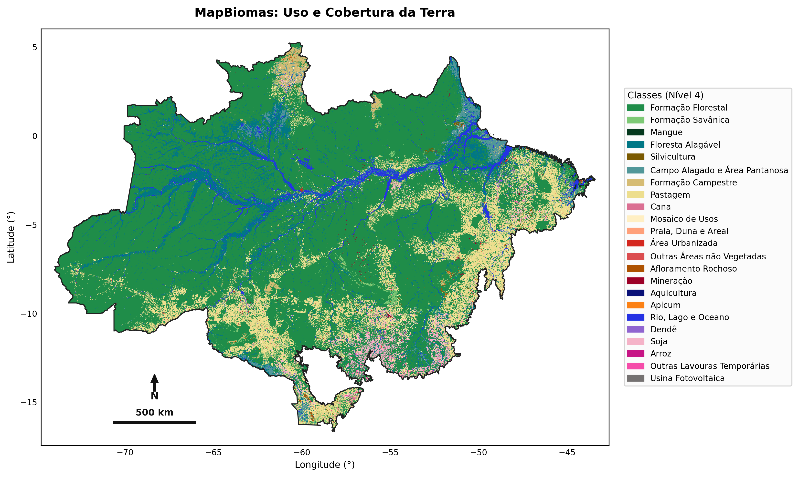
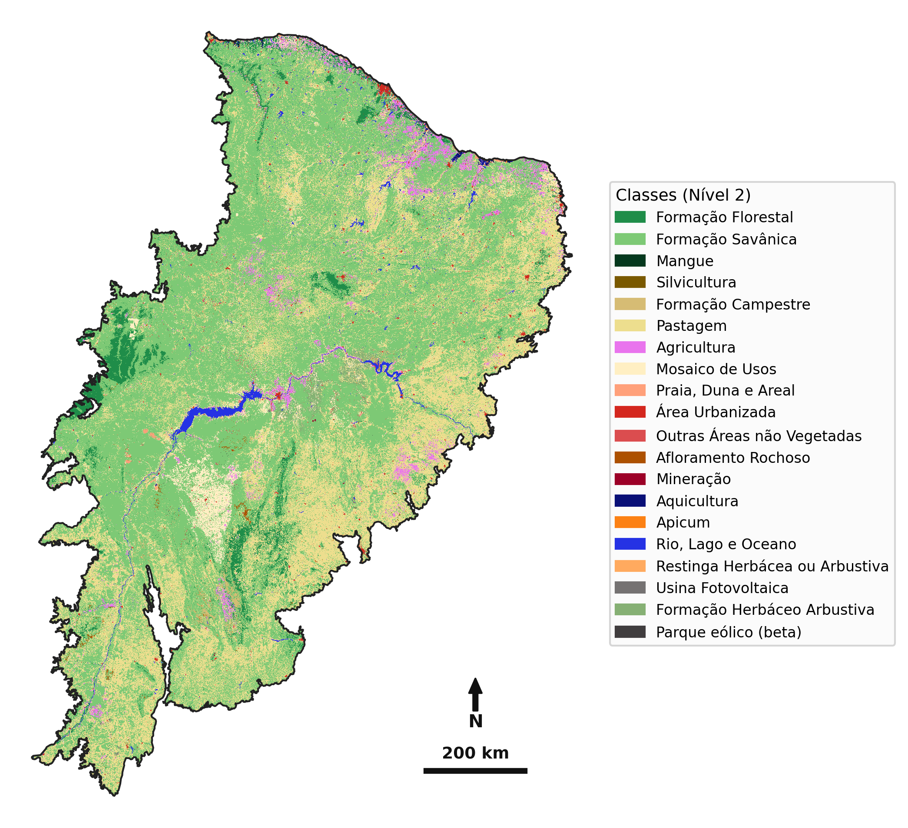
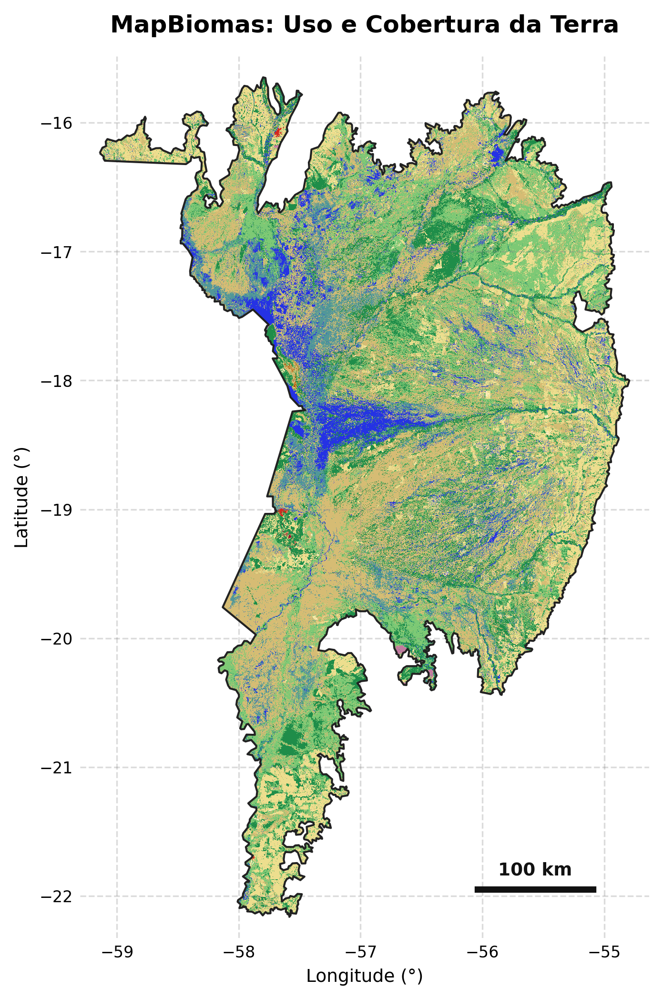

# Mapeamento de Uso e Cobertura da Terra - MapBiomas

Pipeline modular em Python para recorte espacial e exportação cartográfica de dados de uso e cobertura da terra do **MapBiomas Brasil**.

O repositório pode gerar, como saída, mapas em alta resolução (**PNG/SVG**), rasters (**GeoTIFF com compressão LZW**) e mapas interativos para navegador (**HTML**).

---

## Obtenção dos Dados de Entrada

### 1. GeoTIFF do MapBiomas (Uso e Cobertura 2025)
Baixe o raster nacional da Coleção 11 diretamente pelo link do MapBiomas e salve o arquivo na pasta `inputs/geotiff/`:
* **Arquivo:** `brazil_coverage-col11_2025.tif`
* **Download:** [MapBiomas LULC - Collection 11 Coverage 2025](https://storage.googleapis.com/mapbiomas-public/initiatives/brasil/collection11/lulc/coverage/brazil_coverage/brazil_coverage-col11_2025.tif)

### 2. Vetores dos Biomas Brasileiros (IBGE)
O repositório já disponibiliza os arquivos `.geojson` dos 6 biomas brasileiros (deliberação territorial oficial de 2025) na pasta `inputs/vector/`, obtidos a partir do portal do IBGE:
* **Fonte:** [IBGE - Biomas Downloads](https://www.ibge.gov.br/geociencias/informacoes-ambientais/vegetacao/15842-biomas.html?=&t=downloads)

---

## Instalação e Ambiente

Recomenda-se utilizar **Python 3.11 ou superior** para suporte nativo ao módulo `tomllib`.

```bash
# 1. Clone o repositório
git clone [https://github.com/guilherme-couto/mapbiomas-mapping.git](https://github.com/guilherme-couto/mapbiomas-mapping.git)
cd mapbiomas-mapping

# 2. Instale as dependências
pip install -r requirements.txt
```

---

## Configuração

O comportamento do script é parametrizado via arquivos no formato TOML, permitindo alternar regiões, resoluções e opções cartográficas sem alterar o código-fonte:

```toml
[dados_entrada]
# Raster em 'inputs/geotiff/'
geotiff_entrada = "brazil_coverage-col11_2025.tif"

# Vetor da região de interesse em 'inputs/vector/' (suporta .shp, .gpkg, .geojson)
vetor_corte = "amazonia.geojson"

# Coleção de legenda em 'legends/<colecao>.json'
colecao_legenda = "collection_11"

# Nível de agregação (1, 2, 3 ou 4)
nivel_hierarquico = 4

# Resolução desejada em metros (mínimo nativo: 30.0)
# Vai depender da capacidade de processamento, de RAM e do tamanho da área de interesse
# Se receber 'Killed' ou equivalente no terminal, aumente a resolução (ex: 120, 300, 600)
resolucao_metros = 300.0


[mapa_estatico]
formato_figura = "png"         # "png" ou "svg"
show_title = true              # Exibir título do mapa
show_legend = true             # Exibir legenda de classes
show_gridlines = false         # Linhas de grade
show_lat_lon_labels = true     # Graus de latitude e longitude nas bordas
show_frame = true              # Moldura ao redor dos eixos
show_north_arrow = true        # Rosa dos ventos
show_scale_bar = true          # Barra de escala métrica

# Alinhamento da barra de escala e rosa dos ventos
# "auto" (detecta automaticamente o canto com menor densidade de dados)
# Outras opções: "bottom-left", "bottom-right", "top-left", "top-right"
elements_loc = "auto"


[exportacoes_opcionais]
exportar_geotiff = true        # Salva o raster do recorte em 'outputs/geotiff/'
exportar_html = true           # Salva visualização interativa em 'outputs/html/'
```

---

## Execução

### Com arquivo de configuração específico
Passe o caminho de qualquer arquivo de configuração pela flag `-c` ou `--config`:

```bash
# Exemplo 1: Executar o mapa da Amazônia
python3 scripts/main.py --config configs/examples/amazonia.toml

# Exemplo 2: Executar o mapa da Caatinga
python3 scripts/main.py -c configs/examples/caatinga.toml

# Exemplo 3: Executar o mapa do Pantanal
python3 scripts/main.py -c configs/examples/pantanal.toml
```

---

## Hierarquia de Classes (Coleção 11)

A reclassificação hierárquica é administrada dinamicamente pelo arquivo `legends/collection_11.json`, no qual cada classe aponta para sua classe de origem (`parent_id`):

* **Nível 1:** *Floresta*, *Vegetação Herbácea e Arbustiva*, *Agropecuária*, *Área não vegetada*, *Corpo D'água*
* **Nível 2:** *Formação Florestal*, *Formação Savânica*, *Pastagem*, *Agricultura*, *Área Urbanizada*, etc.
* **Nível 3:** *Lavoura Temporária* e *Lavoura Perene*
* **Nível 4:** *Soja*, *Cana*, *Arroz*, *Algodão*, *Café*, *Citrus*, *Dendê*, etc.

Quando um nível intermediário (como Nível 2) é selecionado, os pixels com detalhamento superior (Níveis 3 e 4) são automaticamente convertidos para a respectiva classe-mãe de Nível 2, preservando as cores e nomenclaturas oficiais da legenda.

### Hierarquia personalizada

Caso deseje criar uma hierarquia própria, com nomes e cores específicos, basta criar um arquivo JSON no mesmo formato de `legends/collection_11.json` e apontar o parâmetro `colecao_legenda` para o novo arquivo.

---

## Exemplos de Mapas Gerados

Abaixo estão três exemplos presentes na pasta `outputs/figs/examples/`, gerados a partir dos arquivos de configuração disponibilizados em `configs/examples/`:

### 1. Amazônia (Nível 4) — Detalhamento Máximo
Configuração utilizada: `configs/examples/amazonia.toml`  
*(Gera também mapa interativo em `outputs/html/examples/` e raster em `outputs/geotiff/examples/`)*



---

### 2. Caatinga (Nível 2) — Design Limpo sem Eixos
Configuração utilizada: `configs/examples/caatinga.toml`



---

### 3. Pantanal (Nível 3) — Com Linhas de Grade
Configuração utilizada: `configs/examples/pantanal.toml`

